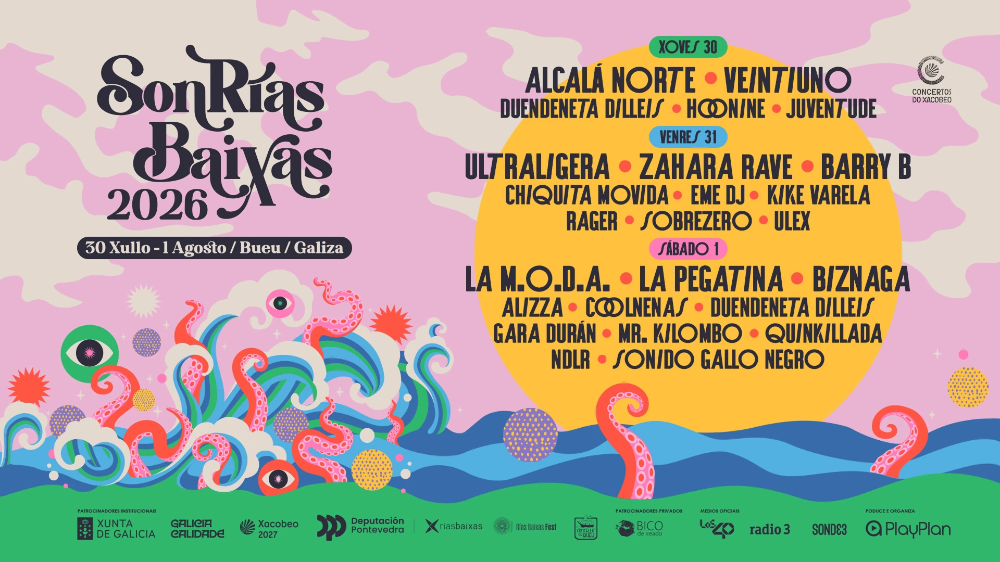
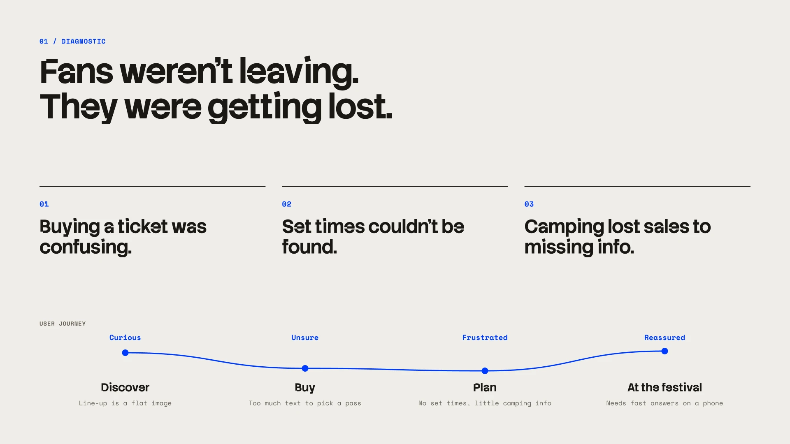
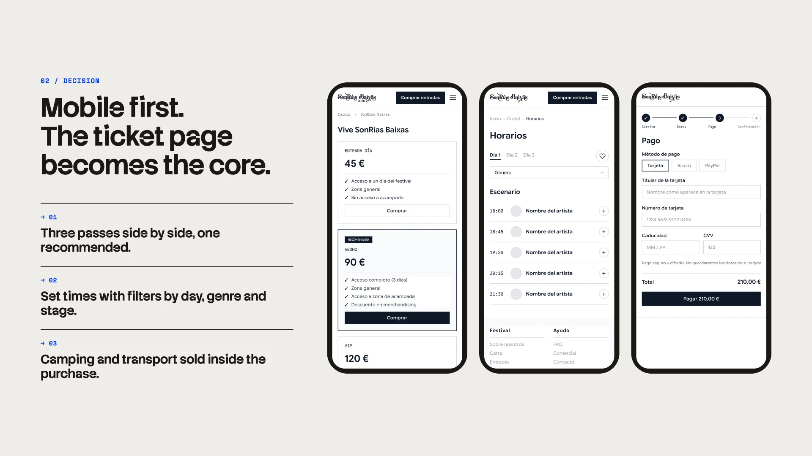
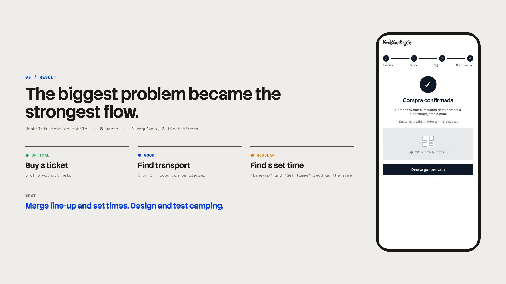
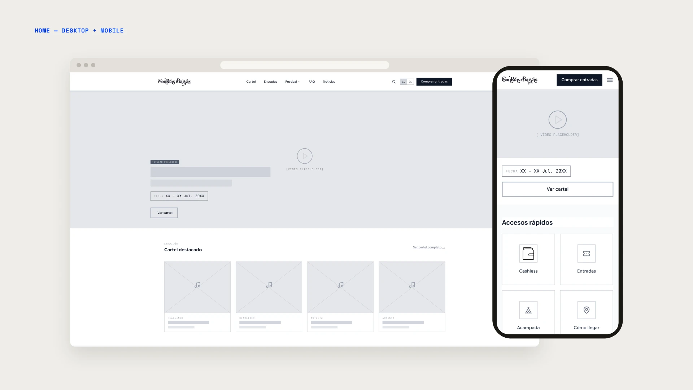
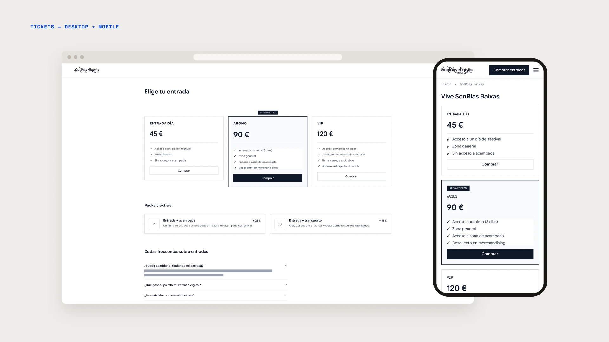
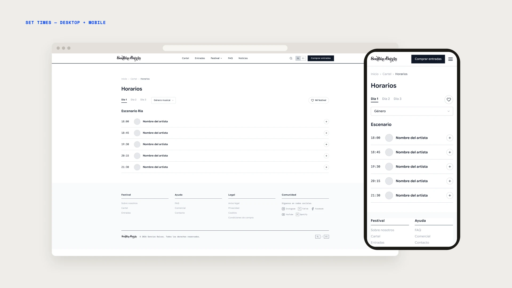
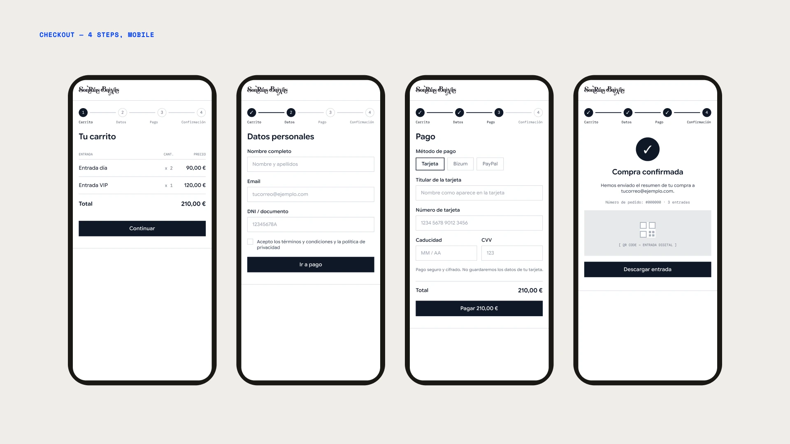
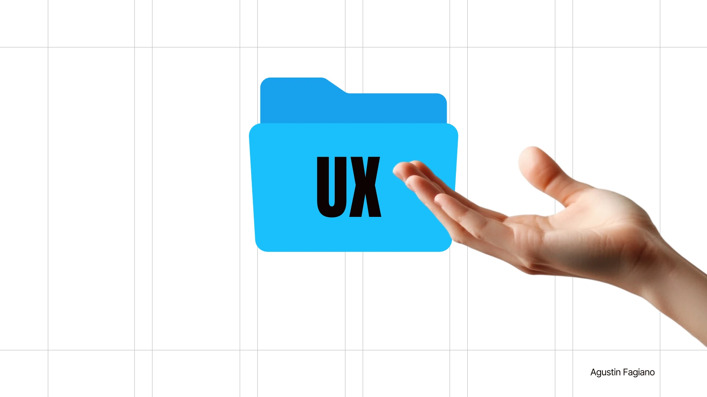

## Diagnostic

Sonrías Baixas is a music festival in the Rías Baixas, Galicia. Most of its audience lands on the website from a phone, usually after seeing the festival on TikTok or Instagram. The site was built for desktop and it showed.

I ran in-depth interviews plus live tasks on the current site. Nobody goes to a festival alone, so the decision is always a group one. Three findings changed the direction:

- **Buying a ticket caused frustration, not abandonment.** People found the link, then spent minutes reading text to work out which pass to pick.
- **Set times were impossible to find.** Users searched the home and the info section and failed. A confirmed task failure, not a hypothesis.
- **Camping lost sales because the information wasn't there.** People wanted to stay. The site didn't give them enough to trust it, so they didn't buy the extra night.

One thing worked: the home video. It was the first thing everyone mentioned.

## Decision

Mobile first, and the ticket page as the core of the site.

- **Three comparable passes, one recommended.** Day, 3-day and VIP side by side, with the 3-day pass marked as recommended so nobody has to read everything to decide.
- **Camping and transport sold as add-ons inside the purchase.** The information gap became a revenue line, not just a FAQ entry.
- **A 4-step checkout with visible progress.** Cart, details, payment (card, Bizum, PayPal), confirmation with a digital QR ticket.
- **Set times with filters by day, genre and stage, plus "My festival"** to build a personal schedule and share it with the group.
- **The video stays as the hero.** It was already doing its job.
- **"Contact" became "Commercial".** Sponsors, press and partners now know where to go.

I brainstormed more than 50 ideas and ranked them by user impact against development effort. Real-time parking, a chatbot and a sponsor meeting scheduler were left out: high cost, little value for someone deciding whether to go.

## Result

A moderated usability test on smartphone with 5 people: 2 regulars and 3 who had never been to the festival.

- **Buying a ticket: optimal.** All 5 reached the confirmation screen without help. The biggest problem in the research became the strongest flow.
- **Finding transport: good.** All 5 completed it. The copy can be clearer.
- **Finding an artist's set time: regular.** All 5 got there, but nobody saw a difference between "Line-up" and "Set times".

What I'd change: merge line-up and set times into one section. For users they were always the same thing. And design and test the camping page, which is the finding with the most direct business impact.

## Gallery

